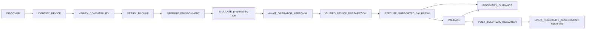

# AEGIS design audit

Audit date: **2026-11-04**. Initial source inspected with `git show` at
**`b99da1cb313845392279792d5ce5701cc03eab99`** (release 0.2.0), together with
the supplied research-first directive and existing repository documentation.
An independently supplied, complete original specification was **not found**.
The six-agent design is reconstructed from source and its README; this audit
does not pretend to have reviewed a missing document. Historical installation
copies, archives and prior reports are supporting materials, not a substitute
for current source or fresh hardware observations.

## Judgment

**VERIFIED source finding:** the existing six “agents” are deterministic Python
classes, not six autonomous language-model processes. The premise that AEGIS
needs to replace six model calls is therefore unsupported. Its useful core
already consists of bounded upstream adapters, an approval-gated workflow,
structured evidence and simulations. Preserve those parts and make their
guarantees more explicit before adding orchestration infrastructure.

**HYPOTHESIS / recommended direction:** retain one local CLI and deterministic
services, with one optional reasoning layer for research interpretation and
reviewed summaries. Permit short parallel research tasks where independent;
serialize physical device access. Firmware/RE and Linux feasibility must remain
usable without jailbreak success. Avoid a second scheduler, vector database,
always-running agent team or forked jailbreak implementation until measurements
show a concrete need.

The initial generic state machine verifies edge order, a caller-supplied boolean
and current-run record existence. It does **not** establish that an arbitrary
record actually justifies a particular gate. This is the highest-priority local
contract weakness. Cross-process physical-operation ownership and bounded
evidence retrieval are the next useful improvements. Typed gate receipts, a
hardware-session lock and evidence-search work in the present working tree are
**changes under review**; this audit makes no claims about their test outcome.

## Reconstructed architecture and capability boundaries

| Existing component | What the initial source actually does | Reasoning/human boundary and missing capability |
|---|---|---|
| A — `DiscoveryAgent` | Reports host/runtime, PATH and package candidates; queries libimobiledevice/libirecovery; observes numeric Apple USB descriptors through an isolated worker or Windows PnP. Preserves missing model/firmware as unknown. | Deterministic. PATH presence does not authenticate a utility or demonstrate working USB drivers. Recovery queries do not establish installed firmware. No model should invent identity from an A10 description. |
| B — `CompatibilityAgent` | Parses release versions, checks target ProductType, build syntax/train, mode, native host and bundled dated policy. Only the reviewed palera1n path can become eligible; other methods remain research alternatives. | Deterministic policy engine. Source research and expert review update policy. Version/build syntax is not an exact firmware catalog. Eligibility is neither approval nor installation success. |
| C — `ReverseEngineeringAgent` | Admits a bounded regular file, checks stability while reading, hashes it and identifies bounded executable-header hints. Returns metadata-only status and blocked deep analysis. | Deterministic admission. Binary-specific interpretation may need a researcher/model. No implemented deep decompilation, symbol recovery or dynamic instrumentation follows merely from capability detection. |
| D — `JailbreakAgent` | Builds a fresh plan, checks one selected target and USB inventory, compatibility, backup and pinned artifact; waits for plan-bound approval; rechecks before one supported upstream invocation. | Deterministic coordinator. The operator authorizes physical change and follows upstream DFU/loader prompts. No exploit development or autonomous firmware modification is implemented. |
| E — `ValidationAgent` | Takes three bounded observations; optionally uses a USB-selected SSH route, an existing identity and host-key pin for device binding, bootstrap/filesystem/package/root checks. | Deterministic checks plus operator bootstrap completion. Connectivity alone is insufficient. `CORE_VALIDATED` has a narrow predicate scope; reboot persistence, graphical package manager and sustained stability remain separate. Recovery is guidance, not automatic restore. |
| F — `LinuxResearchAgent` | Returns a copy of a dated bundled subsystem/milestone report. It neither builds nor boots a kernel. | Deterministic retrieval. Port selection, source review and interpretation require research; payload experiments require separate expertise and approval. Source descriptions cannot certify the owner's hardware. |

Shared services are typed evidence/state/error models, `ProcessRunner`, SQLite
records/export, backup verification and approval handling. Optional local-LLM
summaries are a separate advisory feature with bounded inputs and provenance;
generated advice is excluded from executable gates and future summary inputs.
The repository's six labels can remain for compatibility. Architectural
documentation should call them services to avoid suggesting six inference loops.

Initial-source references: [agents](https://github.com/VonSchugel/AEGIS-iPad/tree/b99da1cb313845392279792d5ce5701cc03eab99/src/aegis/agents),
[models](https://github.com/VonSchugel/AEGIS-iPad/blob/b99da1cb313845392279792d5ce5701cc03eab99/src/aegis/models/core.py),
[CLI](https://github.com/VonSchugel/AEGIS-iPad/blob/b99da1cb313845392279792d5ce5701cc03eab99/src/aegis/cli.py).

## Actual state flow and evidence gates

The state is an in-memory cursor. Transitions and evidence are persisted, but
the initial code does not reconstruct/resume an approved physical workflow from
the database. This conservative restart behavior is useful; do not accidentally
turn a stored transition into replayable authority.

| Gate/action | Initial source requirement | Limit to preserve or improve |
|---|---|---|
| Identify | Exactly one identified device plus successful singleton Apple USB inventory, no discovery blockers | A descriptor is not a model or firmware identity. Multiple/missing observations block. |
| Compatibility | Exact permitted ProductType; well-formed release/build; reviewed host and policy eligibility | Current local policy is a dated review boundary, not upstream maximum support. Do not widen from processor-family similarity. |
| Backup | Completed recent matching local backup; plist/SQLite integrity and referenced regular payload presence | Encrypted backups block this implementation. Checks do not prove content integrity or restoreability. Never weaken encryption to make a gate pass. |
| Prepare | Local official pinned palera1n asset hash before its bounded version probe | A trusted asset still has host/device limitations; preserve artifact and exact argv binding. |
| Simulate | Live path records the prepared dry-run plan; separate fixture simulator exercises transitions | Live plan simulation is not hardware emulation or a reproduction of exploit behavior. |
| Approval | Interactive terminal, exact digest phrase, five-minute lifetime, same plan, single use | Saved/exported plans and fixture approvals confer no physical authority. Library objects assume trusted local code; they are not a remote security boundary. |
| Execution | Fresh target/firmware/host/compatibility/backup checks, artifact/argv verification, one `palera1n -l` invocation | Native Linux/macOS only; Windows/WSL blocked. One 900-second timeout, no automatic physical retry. |
| Validate/recover | Zero upstream exit only permits independent validation; failure/partial state yields guidance | Cancellation cannot undo device changes. No automatic erase, restore, downgrade, repartition or custom payload is allowed. |

Initial-source references: [state machine](https://github.com/VonSchugel/AEGIS-iPad/blob/b99da1cb313845392279792d5ce5701cc03eab99/src/aegis/orchestration/machine.py),
[jailbreak service](https://github.com/VonSchugel/AEGIS-iPad/blob/b99da1cb313845392279792d5ce5701cc03eab99/src/aegis/agents/jailbreak.py),
[approval](https://github.com/VonSchugel/AEGIS-iPad/blob/b99da1cb313845392279792d5ce5701cc03eab99/src/aegis/safety/approval.py),
[backup](https://github.com/VonSchugel/AEGIS-iPad/blob/b99da1cb313845392279792d5ce5701cc03eab99/src/aegis/safety/backup.py),
[palera1n adapter](https://github.com/VonSchugel/AEGIS-iPad/blob/b99da1cb313845392279792d5ce5701cc03eab99/src/aegis/adapters/palera1n.py).

## RE interfaces, independence and evidence semantics

**VERIFIED source finding:** the REA adapter is a capability-selection and reply
parser seam. The caller supplies advertised tool names; the adapter selects a
static allowlist. Its parser requires successful strict JSON, matching text and
structured projections, an evidence identity, normalized result and analysis
profile. It rejects malformed/error replies. This is structural validation,
not provider authentication, signature verification or proof that a live MCP
transport is connected. Per-tool live schemas remain the connecting client's
responsibility. See [REA source](https://github.com/VonSchugel/AEGIS-iPad/blob/b99da1cb313845392279792d5ce5701cc03eab99/src/aegis/adapters/rea.py).

The CLI already exposes `inspect`, `research` and `linux-status` independently.
The sequential post-jailbreak states load research; they do not imply RE or
Linux depends on modification. Make the independent workflows explicit in
documentation and future experiment contracts rather than removing useful CLI
seams. See [RE integration research](reverse-engineering.md) and
[Linux feasibility](linux-feasibility.md) for tool and device-specific choices.

Evidence is run-scoped SQLite JSON, with a typed research-evidence contract and
redacted export. Raw upstream logs are kept separately under a private local
directory; exported records retain hashes and truncation state. The wrapper
appends records, but SQLite is not a cryptographically authenticated or
tamper-proof ledger. Generic event payloads are less constrained than typed
`Evidence`. Distinguish source observation, upstream documentation, simulation,
generated interpretation and physical measurement in every adapter. External
text, binary strings and logs must remain untrusted data, never instructions or
approval. See [evidence store](https://github.com/VonSchugel/AEGIS-iPad/blob/b99da1cb313845392279792d5ce5701cc03eab99/src/aegis/evidence/store.py).

## Capability versus verification

**VERIFIED source inspection:** discovery, conservative compatibility checks,
backup/approval guards, bounded subprocesses, fixture scenarios and metadata-only
artifact inspection are implemented. Test sources exist for illegal edges,
cross-run evidence, expired/replayed approval, target changes, incomplete USB
inventory, malformed backups, subprocess behavior and validation predicates.
Test existence is not a result; fresh execution and measured outcomes belong in
the benchmark/verification report.

**UNKNOWN / not established by this audit:** successful physical installation,
working macOS/native-Linux device adapters on this unit, restoreable backup,
deep REA provider operation, native payload boot, early kernel initialization,
Linux shell, peripheral stability and long-term usability. No claim in a README,
fixture, independent Apple port or successful upstream exit should promote these.

The original broad objectives remain valid, but the implementation currently
delivers a guarded experimental framework rather than autonomous exploit
engineering or a complete Linux distribution. This is a scope statement, not
evidence that the missing capabilities are impossible.

## Explicit assumptions register

| ID | Assumption/status | Evidence and consequence | Validation or resolution |
|---|---|---|---|
| A1 | Separate full original specification unavailable — **UNKNOWN** | Reconstruct from supplied directive and initial source; avoid invented requirements. | Admit and compare any later supplied original document. |
| A2 | Owner-authorized scope — **DOCUMENTED user instruction** | Permits reversible research and read-only discovery; no current physical-modification approval. | Require plan-specific approval before each modifying experiment. |
| A3 | Requested device is J171 or J172 — **DOCUMENTED request**, attached unit **UNKNOWN** | A10 family membership does not identify the actual board. | Fresh ProductType, firmware/build and target binding. |
| A4 | Firmware known from an old filename/report — **HYPOTHESIS rejected** | `SETUP-iPadOS-17.0.3.md` is not a live device observation. | Query observed hardware; preserve unknown if tools unavailable. |
| A5 | Current host can perform physical palera1n — **VERIFIED outside local policy** | Fresh host observation is Windows 11 AMD64; reviewed policy excludes Windows/WSL. Software tests do not establish native USB support. | Native supported-host read-only diagnostics; actual model/firmware remain UNKNOWN. |
| A6 | Six agents mean six LLMs — **VERIFIED false in initial source** | No need for six model sessions or agent framework migration. | Maintain deterministic module boundaries; measure optional inference independently. |
| A7 | Evidence-ID presence proves gate truth — **VERIFIED false in initial source** | Generic records can be unrelated to a target transition. | Gate-bound typed receipts, mode/type/target checks and rejection tests; trusted service still owns truth. |
| A8 | One local CLI means exclusive USB ownership — **HYPOTHESIS unsupported** | Independent processes can overlap; initial source has no common lease. | Shared fail-closed local session ownership; test collision, cancellation and release behavior. |
| A9 | Backup verifier proves recovery — **VERIFIED false by contract** | Manifest/presence checks do not exercise restoreability. | Preserve limits; separately review recovery path without automatic restore. |
| A10 | REA advertisements imply working analysis — **VERIFIED false by adapter contract** | No native provider verified merely by tool/package presence. | Exact provider/version/schema plus known-artifact comparison before accepting deeper findings. |
| A11 | Jailbreak implies Linux — **HYPOTHESIS rejected** | Distinct boot contracts, drivers and physical acceptance criteria. | Independent L0–L5 records with documented/simulated/physical dimensions. |
| A12 | Newer fork is faster/more reliable — **UNKNOWN** | Source additions and author claims are not fair comparative tests. | Same hardware/configuration, defined outcomes and logs; otherwise rank by inspectable capability and risk. |
| A13 | Model summaries improve research quality — **HYPOTHESIS** | Provenance validation checks referenced IDs, not factual entailment. | Held-out reviewed examples, unknown/negation preservation, measured cost and baseline retrieval comparison. |

## Design alternatives

Safety and exact device/firmware compatibility are **mandatory admission
constraints** for every option. A design failing them is rejected regardless of
speed, token use or nominal feature coverage. No comparative performance numbers
were measured for these alternatives; the following are design judgments.

| Option | Strengths | Costs/failure modes | Decision |
|---|---|---|---|
| One capable reasoning agent with deterministic tools | Low coordination overhead; clear ownership; broad questions handled in one context | Serial research latency and context growth; model must not directly decide physical gate truth | Suitable default for small tasks; add shared typed services and evidence retrieval. |
| Central orchestrator plus six permanent model agents | Parallel specialist interpretation where genuinely independent | Repeated context, scheduler/retry complexity and shared-USB conflicts; no demonstrated benefit for deterministic jobs | Reject as default. No need to recreate existing service logic in prompts. |
| Independent parallel researchers with shared evidence | Useful for jailbreak, RE and Linux literature discovery; independent review can expose contradictions | Duplicate claims can appear independent; conflicting file edits and unreviewed source ingestion need ownership | Use selectively for bounded research with structured handoffs, source deduplication and one integrator. |
| Hybrid deterministic execution plus optional research reasoning | Preserves explicit safety contracts, reusable adapters and independent tracks; reasoning concentrated on uncertain questions | Requires disciplined provenance and clear distinction between advice and evidence | **Accept as target.** One local executor and shared evidence services; temporary research parallelism only where justified. |

## Ranked optimization hypotheses and acceptance criteria

These are **HYPOTHESIS** until evaluated; the ranking reflects consequence and
implementation scope, not fabricated weighted scores.

1. **Bind evidence to the gate and mode.** Under-review typed receipts should
   reject unrelated events, wrong targets, failed decisions, duplicate/foreign
   IDs and fixture-to-live promotion. Preserve edge order and narrow trusted
   service authority; a typed receipt does not authenticate hostile Python code.
2. **Own the hardware session explicitly.** One process should hold the common
   lease across each physical workflow segment. Competing workflows fail closed;
   cancellation releases ownership. Do not mistake an advisory lock for control
   over independent third-party USB programs.
3. **Retrieve bounded evidence before reasoning.** Add deterministic source/kind
   filtering and stable identifiers before considering embeddings. Compare
   predefined query precision, latency and input volume against full-history
   rereading. Generated advice remains excluded from authoritative inputs.
4. **Keep research and hardware execution independent.** RE admission and Linux
   status must work without a connected device or approved jailbreak. Add L0–L5
   acceptance records without breaking legacy callers or promoting simulation.
5. **Make freshness and artifact scope explicit.** Pin release/commit/file hashes
   where available; retain checked dates and unresolved exact-build questions.
   A source refresh alone must not widen physical policy or silently switch tools.
6. **Measure before adopting extra engines or agents.** Baseline core latency,
   subprocess failure recovery, resource use and evidence retrieval first. Add
   deep-analysis providers or model specialization only when a representative
   comparison shows better correctness/cost with the mandatory constraints met.

The recommended architecture reuses the existing deterministic services and
introduces one optional research reasoning layer. It preserves independent
firmware/RE and Linux experiment tracks, keeps the modifying adapter narrow and
makes evidence quality and controlled execution the primary product capability.
