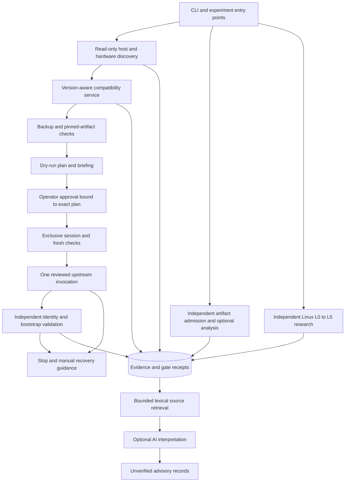

# Optimized architecture and decision record

Decision date: **2026-11-04**. Status: accepted for this working tree, with hardware and provider limits below. The [audit](architecture-audit.md) reconstructs baseline `b99da1cb313845392279792d5ce5701cc03eab99`; [benchmarks](benchmark-report.md) report implementation verification. Design judgments are **HYPOTHESIS** until their stated experiments establish an outcome.

## Decision criteria

Admission is mandatory before optimization: authorized target; unambiguous observed identity; reviewed hardware/firmware/host; completed backup evidence; pinned executable; simulated plan; exact fresh approval. An unknown mandatory precondition blocks execution. Safety and compatibility cannot be offset by a faster implementation.

Among admitted designs, prefer demonstrated correctness and recovery behavior, reproducible artifacts, reuse of maintained upstream interfaces, bounded resource use, independent research workflows and the smallest maintenance surface. Compare equivalent tasks before claiming a speed, reliability or token advantage. No numerical design score is presented because no representative multi-framework experiment has been run.

## Component ownership and flow

The diagram describes responsibilities, not an LLM routing graph. The six existing `agents/` modules remain deterministic services to preserve working interfaces. No resident agent scheduler, message bus, vector database or external workflow service is required. Source inspection, artifact admission, research retrieval and Linux status operate without a jailbreak or connected device.

| Responsibility | Implemented contract | Important boundary |
|---|---|---|
| Discovery | `DiscoveryAgent`, non-pairing Apple queries, numeric USB observations | Missing tools/permissions are unknown, not a negative device identification. |
| Compatibility | `CompatibilityAgent` and dated bundled policy | Version/build syntax and train consistency are checked; exact release/build existence is not catalog-verified. Current physical ceiling remains 18.4.0. |
| Artifact/RE | Regular-file admission, bounded hash/header inspector; optional REA parser seam | Neither a header hint nor an advertised tool is deep analysis. No live REA transport/provider was established. |
| Execution | `JailbreakAgent`, `Palera1nAdapter`, backup and approval modules | One pinned rootless invocation; no alternate exploit, restore, downgrade or payload fallback. |
| State and evidence | `GateReceipt`, `StateMachine`, `EvidenceStore` | Typed service assertions, not independently authenticated truth or a tamper-proof database. |
| Hardware ownership | `hardware_session()` | Cooperative per-user lock across participating CLI commands and plan/execute APIs. External tools/users and direct low-level calls can ignore it. |
| Retrieval | Lazy contentless FTS5 index, insertion trigger, bounded typed results | Only `kind=evidence` rows are returned. Lexical relevance does not establish truth, freshness or execution authority. |
| Linux | `LinuxResearchAgent`, independent `research_milestones` L0–L5 | Documentation, simulation and physical status remain distinct; all local Linux milestones are NOT_TESTED. |
| Interpretation | Existing optional loopback local-model summaries | Generated text is stored separately, cannot issue receipts or approve operations, and is excluded from source retrieval. |

## ADR-001 — Preserve services; keep model reasoning optional

**Accepted.** Hardware queries, version comparison, subprocess deadlines, hash checking and state transitions are deterministic. Model reasoning is useful for contradictory literature, interpreting unfamiliar binaries and designing experiments. Human expertise is required for uncertain boot/driver behavior and approving concrete device changes. No LLM belongs on the mandatory execution path.

**Rejected:** six permanent model-powered agents or a rewrite into a distributed orchestrator. The initial source already avoids those costs. Renaming the package structure would create migration work without a demonstrated capability gain. Revisit if independently scored tasks show a correctness or completion advantage after including all model calls and context transfer.

## ADR-002 — Bind receipts to states and execution mode

**Accepted and implemented.** A receipt carries a target state, strict boolean `passed`, strict boolean `simulated` and the owning service's observation. The machine requires current-run, unique record IDs, `kind=gate_receipt`, matching target/mode and success. An unrelated observation, source citation, model advisory or simulated receipt cannot advance a live machine. Legal edges remain explicit.

**Rejected:** accepting arbitrary current-run record IDs plus caller `satisfied=True` as sufficient structure. The new contract improves misuse resistance; it does not authenticate hostile Python callers or independently re-evaluate every service's observation. Approval, artifact and fresh-device checks still guard the modifying adapter. Historical transition records remain readable; saved records cannot resume or authorize physical execution.

## ADR-003 — Serialize hardware sessions without automatic resumption

**Accepted and implemented.** A nonblocking OS lock covers live discovery/compatibility/validation CLI calls and public plan/execute workflow segments. Planning releases ownership while waiting for human approval. Execution reacquires ownership before fresh identification and holds it through invocation and validation. Busy or unavailable locks fail closed before USB work. The default location is per user and independent of the selected evidence database.

POSIX uses `flock`; Windows uses a nonblocking byte lock. Descriptors are not inherited. The file persists, avoiding unlink/recreate races. There is no PID lease stealing or retry. The [Python POSIX](https://docs.python.org/3.12/library/fcntl.html) and [Windows](https://docs.python.org/3.12/library/msvcrt.html) interfaces document these primitives. Windows behavior was tested; current POSIX behavior awaits Linux execution.

**Rejected:** a database-only lock, automatically expiring lease, automatic physical retry or “resume after crash” assumption. USB side effects are not transactional. Process death can release host ownership while the device state remains unknown; inspect it and rebuild a fresh plan. A different user, external utility or malicious process is outside this coordination boundary.

Abrupt owner death can also leave an upstream subprocess alive. Releasing an OS
lock does not prove that such a process or its USB activity stopped. Reconcile
both host processes and the device before approving a new experiment; this
package does not implement a crash-surviving device arbiter.

## ADR-004 — Retrieve source evidence before adding embeddings

**Accepted and implemented.** SQLite FTS5 adds no new Python package and provides lexical ranking. Indexing is lazy and canonical evidence is validated again when read. Queries use one to eight quoted literal terms, not caller-supplied FTS expressions; outputs retain dates, revisions, confidence and limitations. Payloads, candidates, excerpts and metadata are bounded. Source rows remain unchanged, generated records are excluded and a missing FTS5 build produces a structured unavailable result. See [FTS5](https://sqlite.org/fts5.html).

**Rejected for now:** embeddings, autonomous web ingestion, a knowledge graph or a second database. Small local evidence sets first need reliable source selection and labels. Synthetic lookup improvement is measured in the benchmark; real research relevance and contradictory-source recall remain UNKNOWN. Revisit when a held-out corpus demonstrates a lexical recall problem worth the dependency and evaluation cost.

## ADR-005 — Keep one reviewed execution adapter and separate experiments

**Accepted.** Keep palera1n v2.4 and existing artifact digests, with the conservative local range 15.0–18.4.0. Refresh Dopamine comparison to 3.0.13 without introducing IPA installation. Research newer palera1n branches, PongoOS and custom payload loaders independently. [Compatibility evidence](jailbreak-landscape.md) explains why broad SoC/firmware slogans cannot confer exact-device support.

**Rejected:** automatic fallback between jailbreak implementations, using a newer fork because of its label, enabling untested firmware overrides or treating boot-ROM access as a Linux result. Each new adapter requires its own source/artifact review, host matrix, regression corpus and authorized physical experiment.

## ADR-006 — Preserve Linux and reverse engineering independence

**Accepted.** L0–L5 adds explicit acceptance and documented/simulated/physical dimensions while retaining legacy A–E output for existing consumers. Current post-jailbreak states merely load research; they are not prerequisites for independent `inspect`, `research` or `linux-status`. No experimental boot command was added.

**Rejected:** equating successful jailbreak validation with payload, kernel or peripheral success. The J172 derivative is a valuable source-review lead, not a portable Linux distribution for both boards. Provider upgrades are also deferred: latest Ghidra and the checked REA release have different documented runtime requirements. See [Linux](linux-feasibility.md) and [RE](reverse-engineering.md).

## ADR-007 — Keep a small verified development environment

**Accepted.** Use an isolated Python 3.12+ environment, existing pinned Pydantic/Click and pytest. The actual local baseline uses Python 3.12.14. Preserve known dependencies while evaluating upgrades separately. Asyncio with argument arrays, bounded streams, deadlines and cancellation already covers local subprocess requirements; it needs no service scheduler.

**Rejected for this phase:** adding LangGraph, Pydantic AI, Temporal or a cloud-agent dependency to the physical workflow. Their persistence/delegation features are useful for different workloads, but no current requirement needs replayable device-side effects. Review the [agentic configuration](agentic-configuration.md) for evidence, budgets and the experiment that would change this decision.

## Residual limits

Exact target and firmware are UNKNOWN on the observed Windows host. Apple communication tools, cross-toolchains and native analysis providers are unavailable there. Encrypted backups block the current verifier; keep protected backups and resolve verification separately. Fresh Linux/macOS USB tests, artifact-corpus comparisons, backup recovery validation and approved device experiments remain prerequisites. SQLite evidence can be edited outside the application; assertions from untrusted repositories/logs never become instructions or authority. No physical success or native Linux boot is claimed.
